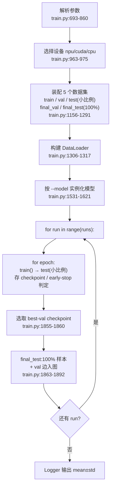
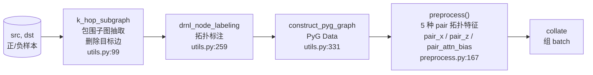
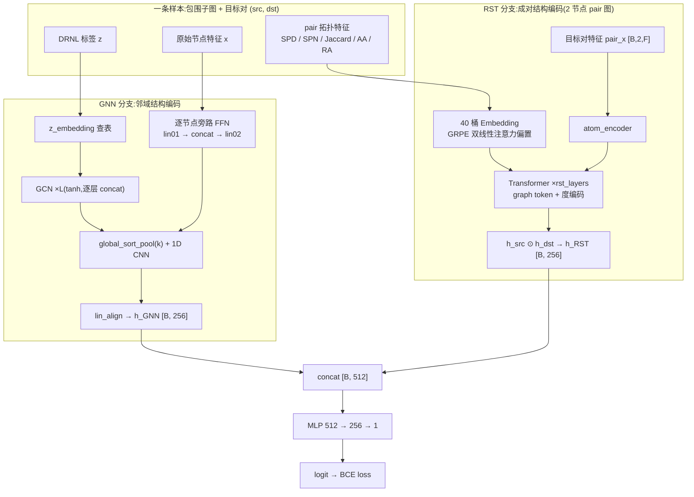
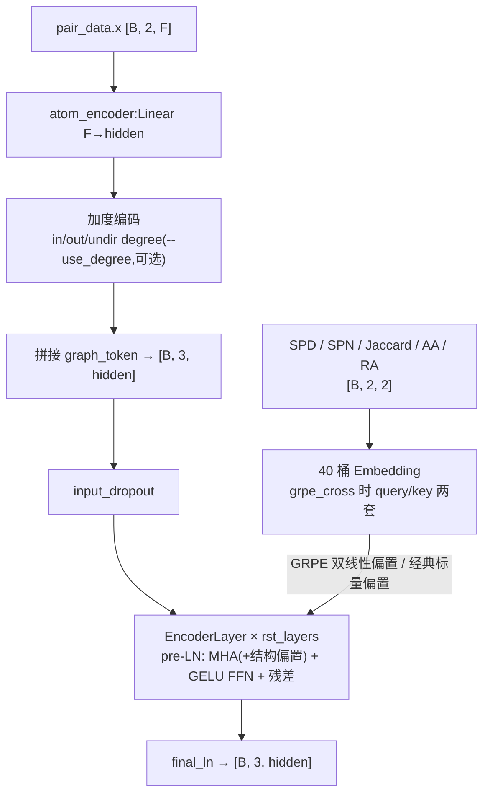
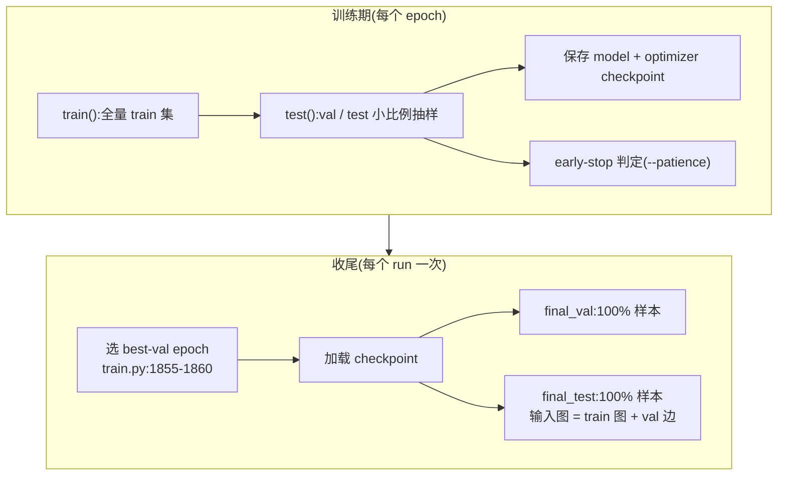

# PyG 框架 TAGNN(链路预测)模型:从入门到精通

TAGNN(Topology-aware Graph Neural Network)是一个用于链路预测的图神经网络框架,发表于 *Scientific Reports*([论文链接](https://www.nature.com/articles/s41598-026-48184-0),2026)。它的代码以 PyTorch Geometric 为主线框架,本文也以该路径为主线;仓库中另有一条 DGL 实现路径(`ngnn_code`,用于 citation2/ppa),文中作为对照出现。

全文依次覆盖:任务背景与论文概览、代码地图、数据流水线、模型实现、设计动机、训练与评估协议、工程实践;附录给出超参对照、术语表与论文↔代码差异。阅读前提为熟悉 PyTorch,不要求图学习背景。

---

# 第一部分 任务与论文概览

## 第 1 章 链路预测:图上的"猜边"任务

### 1.1 问题定义

给定一个图 $G = (V, E)$,以及一条**还没有出现在 $E$ 里的节点对** $(u, v)$,判断这条边"是否应该存在"。二分类问题:正样本=真实存在但被隐藏的边,负样本=随机配对的不存在边。

应用场景:知识图谱补全(缺的三元组)、好友推荐(社交图)、药物相互作用预测(药物图)、引文推荐(论文引用图)。本仓库对应 OGB(Open Graph Benchmark)的三个官方链路预测数据集:

| 数据集 | 图的含义 | 评估指标 | 是否有向 |
|---|---|---|---|
| ogbl-vessel | 血管网络(节点=血管段) | AUC | 否 |
| ogbl-citation2 | 论文引用 | MRR | 是 |
| ogbl-ppa | 蛋白质相互作用 | Hits@K | 否 |
| Cora/Citeseer/Pubmed(Planetoid) | 论文引用(小图,本地快速实验) | AUC | 否 |

### 1.2 传统启发式:图算法时代的答案

在深度学习之前,链路预测靠**手工设计的拓扑分数**(记 $\Gamma(u)$ 为 $u$ 的邻居集合)。TAGNN 论文(以及代码里的特征开关)用的正是这一族:

| 启发式 | 直觉 | 公式 | 代码开关 |
|---|---|---|---|
| CN(公共邻居) | 两人共同好友越多越可能认识 | $\lvert \Gamma(u) \cap \Gamma(v) \rvert$ | (隐含在其余几个中) |
| Jaccard | 共同邻居占比 | $\dfrac{\lvert \Gamma(u) \cap \Gamma(v) \rvert}{\lvert \Gamma(u) \cup \Gamma(v) \rvert}$ | `--use_cnb_jac` |
| Adamic-Adar | 共同邻居里"冷门"节点更有说服力 | $\displaystyle\sum_{w \in \Gamma(u) \cap \Gamma(v)} \frac{1}{\log \deg(w)}$ | `--use_cnb_aa` |
| RA(资源分配) | 类似 AA,但衰减更快 | $\displaystyle\sum_{w \in \Gamma(u) \cap \Gamma(v)} \frac{1}{\deg(w)}$ | `--use_cnb_ra` |
| SPD | 直接连通性 | $\mathrm{dist}(u, v)$ | `--use_len_spd` |
| SPN | 最短路径的条数(连通鲁棒性) | $\lvert \{ P : P \text{ 是 } u \to v \text{ 最短路} \} \rvert$ | `--use_num_spd` |

**局限**:每个启发式只是一个标量,互相独立、无法与节点内容特征(如论文文本)融合,也无法端到端学习。这正好为"用神经网络学组合"留下空间——TAGNN 的做法不是发明新的启发式,而是**把这 5 个特征开关对应的结构量做成可学习的注意力偏置,让模型自己学组合权重**(第 6 章)。

### 1.3 表示学习方法的三步演进

1. **GNN 消息传递**(GCN/SAGE/GIN):节点交换邻居信息得到向量,再用向量相似度猜边。问题:两点间的结构信息要经多跳传播,感受野受限,远距离对的表示区分度差。
2. **SEAL 范式(本仓库的骨架)**:把"预测一条边"改写成"对边的**包围子图**做分类"。核心是**标注技巧(labeling trick)**:按"到 $u$、$v$ 的远近"给子图里每个节点打上整数标签(即 DRNL,第 4.3 节),让 GNN 一眼识别目标。本仓库 `utils.py`/`dataset.py` 整体继承自 SEAL 官方代码。
3. **图 Transformer(Graphormer 一族)**:把子图摊平成序列,用注意力建模,图结构以"注意力偏置"形式注入。代价:对 $n$ 个节点是 $O(n^2)$ 注意力。

**TAGNN 的位置**:站在 SEAL 的子图骨架上,把第二阶段(GNN)和第三阶段(Transformer)杂交成一个**双分支模型**,并且对两者都做了针对性改造(第 2 章)。

## 第 2 章 TAGNN 论文一览:它解决什么问题

### 2.1 论文主张的两大创新

1. **丢弃邻居特征(noNeigFeat)**:GNN 消息传递时**只喂 DRNL 拓扑标签**,不喂邻居的原始属性特征;原始特征只通过旁路 FFN 注入。理由:邻居属性对"猜这条边"是任务无关噪声,拓扑才是主信号。
2. **结构增强 Transformer(RST)与结构增强注意力(RSA)**:把 1.2 节的启发式做成**可学习的注意力偏置**,并且**只对目标节点对做注意力**(pair 图只有 2 个节点)——注意力范围从"整个子图 $O(n^2)$"缩到"目标对 $O(1)$",论文报告相对全连接 Transformer 基线(FCT)**快 10–16 倍**(FCT 在大图上直接 OOM)。

### 2.2 论文主结果(TAGNN w/o NF)

| 数据集 | 指标 | 数值 |
|---|---|---|
| ogbl-ppa | Hits@100 | 63.22(第一) |
| ogbl-citation2 | MRR | 89.87(第一) |
| ogbl-vessel | AUC | 96.87(第二) |
| Pubmed / Cora / Citeseer | AUC | 98.74 / 93.92 / 92.10 |

比 Graphormer 高 0.23–4.58 pp,比 NBFNet 高 0.85–2.95 pp。

**关键消融**(第 8 章逐条展开):去邻居特征**全部 6 个数据集都涨**(0.24–1.34 pp);去掉 RST 在 ogbl-vessel 掉 12.17 pp;去掉 GNN 在 ogbl-ppa 掉 29.76 pp——双分支缺一不可。

---

# 第二部分 代码地图

## 第 3 章 仓库全景与运行入口

### 3.1 文件地图

```
TAGNN/
├── train.py               ★ 总入口:参数、数据集装配、训练/评估循环(~1900 行)
├── models.py              ★ PyG 路径的模型动物园(GCN/SAGE/GIN/DGCNN/各*Graphormer)
├── dataset.py             ★ SEAL 三种数据集类(Iterable/Dynamic/InMemory)
├── utils.py               ★ 子图抽取、DRNL、启发式分数、负采样、Logger(继承 SEAL)
├── preprocess.py          ★ preprocess():给 pair 图算 5 种拓扑特征(preprocess_full 为全图版)
├── graphormer/
│   ├── model.py           ★ RST 本体:Graphormer/EncoderLayer/GRPE-cross 注意力
│   └── collator.py        --use_full_graphormer(全图 Graphormer 基线)的 padding 组 batch
├── ngnn_models.py         DGL 版 DGCNN(+NGNN 嵌套 GNN)实现,citation2/ppa 用
├── ngnn_utils.py          DGL 版子图抽取/DRNL(ngnn_code 路径)
├── wp_utils.py / seal18_utils.py  另两条基线路径(--wp_code / --seal18_code)
├── collection.py          集合运算工具(加速 set 交并差)
├── timer_guard.py         环境变量门控的性能计时器(第 10 章)
├── train_vessel.sh / train_citation2.sh / train_ppa.sh   README 命令的脚本版
└── dataset/ results/ train_log/   数据、实验结果与日志输出目录
```

### 3.2 三条代码路径

`train.py:1047` 开始按 flag 分叉,共三条路径:

| 路径 | 触发条件 | 框架栈 | 数据集类 | 模型来源 | README 用于 |
|---|---|---|---|---|---|
| `sieg_code`(默认) | 不加 flag | PyG + scipy + networkx | `SEALDynamicDataset` / `SEALIterableDataset` | `models.py` | ogbl-vessel |
| `ngnn_code` | `--ngnn_code` | **DGL** + PyG(混合) | `SEALOGBLDataset`(train.py:130) | `ngnn_models.py` | ogbl-citation2 / ogbl-ppa |
| `wp_code` / `seal18_code` | 对应 flag | 各自独立 | — | — | 旧基线;`wp_code` 依赖的 `drnl.py` 未随仓库分发,导入失败时自动降级禁用(train.py:100-106) |

> 默认路径在源码中称 `sieg_code`,系沿用上游仓库名,即 PyG 主路径。

两条主路径**共享同一套模型思想**(DGCNN 分支 + Graphormer 分支),差别在:DGL 路径用 `dgl.nn.GraphConv` + DGL 的子图 API,且 NGNN 版本支持 `--ngnn_type input/hidden/output/all` 控制**哪些层**用嵌套 GNN 头。

### 3.3 README 命令逐参数解读(以 ogbl-vessel 为例)

```bash
python3 train.py \
  --hidden_channels 128 \          # GNN 隐层维度
  --max_nodes_per_hop 100 \        # 每跳子图节点数上限(控制子图规模,防大度数节点爆炸)
  --grpe_cross \                   # ★ RST 用 GRPE-cross 双线性注意力(第 6.3 节)
  --num_heads 8 \                  # 注意力头数
  --dataset ogbl-vessel --use_feature --use_feature_GT --use_edge_weight \
  --epochs 20 --runs 10 --batch_size 256 --lr 0.0001 --num_workers 24 \
  --model DGCNNGraphormer_noNeigFeat \   # ★ 论文的 TAGNN(PyG 路径版本)
  --dynamic_train --dynamic_val --dynamic_test \   # 子图在线动态抽取(第 4.4 节)
  --use_len_spd --use_num_spd --use_cnb_jac        # 启发式特征开关(SPD/SPN/Jaccard)
```

`--use_feature`:原始特征进 **GNN 旁路 FFN**;`--use_feature_GT`:原始特征进 **Graphormer(GT)的 atom_encoder**。两个开关分别控制两条分支的特征入口——这是理解本仓库参数系统的关键。

> ⚠ README 命令是历史实验命令,与论文 Implementation details 的超参不完全一致(附录 A 有逐项对照)。**按论文复现请以第 9.4 节的论文协议参数为准。**

### 3.4 一次训练的完整生命周期



注意 **5 个数据集**的设计:训练过程中的 val/test 只是**抽样**(如 citation2 用 4%/0.2%),目的是廉价地选 checkpoint;真正汇报的数字来自 `final_test`。这个协议在第 9 章展开。

---

# 第三部分 数据流水线

## 第 4 章 从全图到一个 batch

一条样本的诞生路径(`sieg_code` 动态模式):



### 4.1 边划分与负采样

- **OGB 数据集**:用官方 `split_edge`(train/valid/test),test 评估协议也是官方定义的(如 citation2 是"每个 source 对 1000 个候选 target 排序取 MRR")。
- **Planetoid(Cora 等)**:官方没给边划分,`do_edge_split`(utils.py:395)自己切 80/10/10(`val_ratio=0.1`),负样本用 PyG `negative_sampling` 生成 1:1。
- `get_pos_neg_edges`(utils.py:458)统一取正/负边,并用 `np.random.seed(123)` 固定**子采样**的置换——注意这是硬编码种子,保证 `--train_percent 8` 每次抽到同一批边(可复现性关键细节,第 10.5 节)。

### 4.2 k-hop 包围子图抽取:`k_hop_subgraph`(utils.py:99)

对目标对 $(u, v) = (\mathrm{src}, \mathrm{dst})$:

1. 初始 `nodes = [src, dst]`(**顺序不变量:目标节点永远在 0、1 位**——后面所有模块都依赖这一点);
2. 逐跳 BFS:`fringe = 一跳邻居 - visited`,每跳可按 `sample_ratio` 随机采样、或截断到 `max_nodes_per_hop`(vessel=100,论文协议=200)。这就是"包围子图(enclosing subgraph)":只保留 $k$ 跳内接触过 src 或 dst 的节点;
3. 取 $A[\text{nodes}][:, \text{nodes}]$ 导出子图邻接阵,**并把 `subgraph[0,1]`、`subgraph[1,0]` 清零——删掉目标边本身**(否则模型直接"背答案");
4. `enclose_index`(utils.py:77)是 tensor 加速版:只保留两端都在 `nodes` 里的边并重映射列号。

**为什么只取 $k$ 跳?** DRNL 标签在 $k$ 跳外全是"无穷远",信息量为 0;限定 $k$ 也把开销从 $O(\text{全网})$ 降到 $O(\text{子图})$。vessel 大度数节点多,`max_nodes_per_hop` 是防止单样本子图上万的保险丝。

### 4.3 DRNL 标注:`drnl_node_labeling`(utils.py:259)

Double Radius Node Labeling,给子图每个节点 $w$ 打一个整数标签:

$$
d(w) = d(w, u) + d(w, v), \qquad
z(w) = 1 + \min\big(d(w,u),\, d(w,v)\big) + \left\lfloor \tfrac{d(w)}{2} \right\rfloor \cdot \left( \left\lfloor \tfrac{d(w)}{2} \right\rfloor + \big(d(w) \bmod 2\big) - 1 \right)
$$

其中 $z(u) = z(v) = 1$。直觉:两层信息编码进一个整数——**半径**(离较近目标的距离)决定数量级,**距离和的奇偶/大小**做细分。目标:把"谁是目标、各节点与目标的关系"变成 Embedding 可查的分类特征(`max_z=1000` 的查表,models.py:55)。

两个容易被忽略的细节(代码注释未说明):
- 计算 $d(w, u)$ 时在邻接阵里**临时删掉 $v$**(utils.py:265-271),否则任何节点经 $w \to v \to u$ 这条"假捷径"距离都会失真;
- 删行导致索引偏移,所以算 $d(w,v)$ 时用 `indices=dst-1`(utils.py:273)。

> 仓库还备有 `de`/`de+`/`zo`/`hop` 等其他标注(`construct_pyg_graph`,utils.py:331,`--node_label` 选择),论文与所有默认命令均用 `drnl`。

### 4.4 三种数据集类与"动态抽取"

| 类(dataset.py) | 行为 | 适用 |
|---|---|---|
| `SEALDataset`(452) | 一次性预抽取全部子图存盘(InMemoryDataset) | 小数据 |
| `SEALDynamicDataset`(573) | `__getitem__` 时现场抽取+DRNL+preprocess | ★ 训练训练集(shuffle 每 epoch 重采) |
| `SEALIterableDataset`(23) | 按 1024 条一个 slice 现场抽取,**切片缓存成 .pt**,worker 按切片号分活 | ★ 大规模 val/test(避免重复算) |

`--dynamic_train/val/test` 即选择 Dynamic/Iterable。**动态抽取的意义**:val/test 用 Iterable 的磁盘缓存换时间;train 必须动态,因为负样本和子图若固定,10 个 run 会见过完全相同的子图(泛化变差)。Iterable 的 worker 划分逻辑在 `__iter__`(dataset.py:224-238):`worker_pts` 把切片区间均分给 `num_workers` 个进程,切片文件名带样本区间(`slice07_in_61(sample7168-8191).pt`),**文件名即缓存键**。

`preprocess_fn` 的结构特征也有独立缓存(`{dirname}_struct/`):第一次算完 5 拓扑特征存盘,之后直接 `torch.load`(dataset.py:255-269)——networkx 计算是整条流水线最贵的 CPU 环节(第 10.1 节)。

### 4.5 `preprocess()`:pair 图组装(preprocess.py:167)

这是论文"注意力只看目标对"的数据侧实现,仅在 `--model` 名含 `Graphormer` 时接线(train.py:1036-1045),纯 DGCNN 基线不受影响。对每个子图(目标节点在 0、1 位):

```python
center_indices = np.array([0])          # 目标 src 恒在第 0 位(dst 在第 1 位)
G_undirected = to_networkx(子图, to_undirected=True)   # 在包围子图上建 networkx 图
# ① 五个 [1, 2, 2] 矩阵(目标对两两之间,对角线填 0):
pair_len_shortest_path  = nx.shortest_path_length(G, 0, 1)      # SPD,不连通 → long max
pair_num_shortest_path  = len(nx.all_shortest_paths(G, 0, 1))   # SPN
pair_undir_jac = nx.jaccard_coefficient(G, [(0,1)])             # 在子图上算!
pair_undir_aa  = nx.adamic_adar_index(G, [(0,1)])
pair_undir_ra  = nx.resource_allocation_index(G, [(0,1)])
# ② pair 图本体:
data.pair_x  = [1, 2, F]        # 两个目标节点的原始特征
data.pair_z  = [1, 2]           # 两个目标的 DRNL(恒为 1)
data.pair_edge_idx = [[0,1],[1,0]]   # 虚构的目标间边(占位)
data.pair_attn_bias = zeros([1, 3, 3])   # 3 = 2 节点 + 1 个 graph token
```

**核心机制**:RST 分支看到的"图"只有 2 个节点,结构信息(5 个启发式)则是在整个包围子图上计算后浓缩进 $[2,2]$ 矩阵注入的——结构计算发生在数据侧,RST 只消费结果。这同时解释了:
- 为什么 RST 注意力是 $O(1)$/样本(2 节点 + 1 token = $3 \times 3$ 注意力矩阵);
- 为什么 `preprocess_full`(preprocess.py:317,配 `--use_full_graphormer`)存在——它是消融对照:对**全子图所有节点对**算特征($n \times n$ 矩阵),即论文里的全连接 Transformer 基线。

**不连通处理**:`NetworkXNoPath` → SPD 记 `iinfo(long).max`,SPN 记 0(preprocess.py:262-266);下游 `torch.clamp(min=0, max=39)` 会把它压到桶 39——即"非常远"和"不可达"共享一个桶,工程上的可接受妥协。

### 4.6 组 batch

- **sieg 路径**:PyG `DataLoader` 默认 collate,`pair_*` 字段按第 0 维拼接 → $[B,2,2]$、$[B,3,3]$ 等,天然正确。
- **ngnn 路径**:DGL 把子图 batch 成大图,但**自定义属性不会跟着 `.to(device)` 走**,所以 `ogbl_collate_fn`(train.py:1413)手工拼 pair 字段、`train()`(train.py:300-319)手工逐字段 `.to(device)`——这是 DGL+自定义属性的经典坑,排查"字段在 CPU 上报错"时先看这里。
- **full_graphormer 路径**:子图节点数不一,`graphormer/collator.py` 手工 padding:attn_bias 的 pad 区填 $-\infty$(softmax 后权重为 0),特征/位置 pad 后 **+1**(0 留给 padding embedding,`padding_idx=0`)。

---

# 第四部分 模型

TAGNN 总体架构(以论文主模型 `DGCNNGraphormer_noNeigFeat` 为例):



## 第 5 章 GNN 分支:邻域结构编码

### 5.1 模型动物园总览(models.py)

`models.py` 是一个"模型动物园":既有 SEAL 风格的基线,也有逐步叠加出论文主模型的消融变体。下表按论文角色分组,类名后的括号内是定义行号:

| 类 | 定位 | 论文角色 |
|---|---|---|
| `GCN` / `SAGE` / `GIN`(48/128/428) | SEAL 风格基线:center pooling 出 logit | 基线 |
| `DGCNN`(207) | SortPooling + 1D CNN 基线 | 基线(SEAL 默认) |
| `DGCNN_noNeigFeat`(320) | DGCNN + 特征走旁路 FFN | 消融中间态 |
| `GCNGraphormer`(528) | GCN 分支 + Graphormer,两分支都吃特征 | 消融中间态 |
| `GCNFFNGraphormer`(634) / `GCNGraphormer_noNeigFeat`(747) | 同上,特征进 FFN 变体 | 消融 |
| `DGCNNGraphormer`(1067) | DGCNN 分支 + Graphormer | 消融(带邻居特征版) |
| **`DGCNNGraphormer_noNeigFeat`(1233)** | ★ 论文 TAGNN,sieg 路径(vessel/Cora) | **主模型** |
| **`NGNNDGCNNGraphormer_noNeigFeat`(1498)** | ★ 论文 TAGNN,ngnn 路径(citation2/ppa) | **主模型** |
| `FFNGraphormer` / `SingleFFN` / `SingleGraphormer` | 单分支消融 | 消融 |
| `NGNNDGCNNGraphormer`(1413) | NGNN 版带邻居特征 | 消融 |

命名规则读法:`X + Graphormer` = X 分支 + Graphormer 分支;`noNeigFeat` = GCN 不吃邻居特征。

### 5.2 目标结构:`DGCNNGraphormer_noNeigFeat`(models.py:1233)

forward 逐段如下(models.py:1330,形状以 Cora 论文协议 batch 为例,hidden=128,$L$=2,mlp=256,$F$=871):

```python
z_emb = self.z_embedding(z)             # [N_total, 128]  DRNL 标签查表(max_z=1000)
h = z_emb                               # ★ GCN 输入只有拓扑标签——"noNeigFeat"就在这一行
ffn_feat = x.to(torch.float)            # [N_total, 871] 原始特征,只给旁路 FFN

# --- 阶段 1:GCN 堆叠,tanh 激活,逐层 concat ---
hs = [h]
for conv in self.convs:                 # 每层 GCNConv,最后一层输出 1 维
    hs += [torch.tanh(conv(hs[-1], edge_index, edge_weight))]
h = torch.cat(hs[1:], dim=-1)           # [N_total, L*128+1] = [N_total, 257]
h = F.dropout(h, p, training)           # 论文协议 dropout=0.5

# --- 阶段 2:节点特征旁路 FFN,注入回每层表示 ---
h_feature = F.relu(self.lin01(ffn_feat))    # [N_total, 128]
h = torch.cat((h, h_feature), dim=1)        # [N_total, 257+128]
h = F.relu(self.lin02(h))                   # [N_total, 257]  拉回与 concat 同宽
h = F.dropout(h, p, training)

# --- 阶段 3:SortPooling + 1D CNN(经典 DGCNN 头) ---
center_indices = np.unique(batch.cpu().numpy(), return_index=True)[1]   # 每个子图第 0 个节点的全局下标
h = global_sort_pool(h, batch, self.k)  # [B, k*257]  按最后一维(=结构签名)降序取前 k 个节点
h = h.unsqueeze(1)                      # [B, 1, k*257]  当作一维"信号"
h = F.relu(self.conv1(h))               # kernel=stride=257 → [B, 16, k]
h = self.maxpool1d(h)                   # [B, 16, k/2]
h = F.relu(self.conv2(h))               # kernel=5 → [B, 32, k/2-4]
h = h.view(B, -1)                       # [B, dense_dim]
h = F.relu(self.lin_align(h))           # [B, 256]  ← GNN 分支输出 h_ij^GNN

# --- 阶段 4:RST 分支(第 6 章),取两个目标节点表示做乘 ---
h_graphormer = self.graphormer(pair_data)   # [B, 3, 256](graph token + 2 节点)
h_prod = h_graphormer[:,0,:] * h_graphormer[:,1,:]   # [B, 256]  ← h_ij^RST

# --- 阶段 5:解码(readout_type=0:乘积拼接) ---
h = torch.cat((h, h_prod), dim=-1)      # [B, 512]
h = F.relu(self.lin1(h)); h = F.dropout(h, p, training)
h = self.lin2(h)                        # [B, 1]  logit → BCEWithLogitsLoss
```

**几个"为什么"**:
- **为什么 tanh 不用 relu?** DGCNN 原论文设定:$\tanh$ 把逐层输出压到 $(-1,1)$,使 SortPooling 按"最后一维排序"时不同层之间量纲可比,1D CNN 才能把层维当"通道"卷。
- **SortPool 在排什么?** `global_sort_pool` 按节点表示的**最后一个通道**的值给子图内节点排序,保留前 $k$ 个。最后一维是最后一层 GCN(1 维输出)的值≈节点的"结构显著度"。$k$ 是超参,`sortpool_k=0.6` 表示取"子图节点数的 60% 分位数"自适应算出(models.py:1247-1259,采样 1000 个子图统计)。它同时解决"子图大小不一"和"给 CNN 固定长度输入"两件事。
- **为什么特征走 FFN 而不是拼进 GCN 输入?** 这就是 noNeigFeat:特征若拼进输入,会随消息传递扩散到邻居,论文认为这是噪声注入;走逐节点 FFN 则特征不参与消息传递,只"修饰自己"。注意 FFN 编码的是**全部节点**的特征再和 GCN 输出 concat——但下游 SortPool/CNN 是子图级池化,特征最终只通过目标节点附近的表示影响输出。彻底"只目标节点"的变体是 `GCNGraphormer_noNeigFeat` 的 `z_emb_agg=False` 分支(models.py:767,特征+z 一起进 FFN)。

### 5.3 NGNN:嵌套 GNN(ngnn_models.py,ngnn 路径用)

NGNN(Nested GNN)思想:**每一层消息传递都配一个独立的输出头**,各层输出拼起来作为子图表示——让"子图级表示"对每层的子结构都敏感,而不只看最后一层。

`NGNN_GCNConv`(ngnn_models.py:9):`conv → relu → fc → relu → fc2`(`num_ngnn_layers=2` 时),相当于"层内小 MLP"。`--ngnn_type`:
- `input`:第 1 层用 NGNN 头,后面普通;
- `hidden`:中间层;`output`:最后层;`all`:全部。
ppa 命令用 `--ngnn_type input --num_ngnn_layers 1`(只有输入层带头)。

DGL 版 `DGCNN_noNeigFeat`(ngnn_models.py:150)与 5.2 的 PyG 版逐段对应,差别仅:DGL `GraphConv`/`SortPooling`、dropout 加在每层 conv 之后、`output_embedding=True` 时返回 dense 向量(交给外层的 `lin_align`)。

### 5.4 GCN 基线的 center pooling(models.py:111)

基线 GCN/SAGE 不做子图分类,而是在节点级表示上直接取两个目标节点:

```python
_, center_indices = np.unique(batch.cpu().numpy(), return_index=True)   # 每图起始下标
x = x[center_indices] * x[center_indices + 1]     # h_src ⊙ h_dst 逐元素乘
```

乘法是对称双线性:正样本(目标间拓扑关联强)倾向得到同号大值。这一"取两个中心点"的模式在所有 *Graphormer 里也复用(h_src⊙h_dst)——它是贯穿全仓库的又一不变量(第一个是 4.2 节的"目标节点固定在 0、1 位")。

## 第 6 章 RST 分支:结构增强 Transformer(graphormer/model.py)

### 6.1 类结构总览(Graphormer,graphormer/model.py:131)

继承 Graphormer 的骨架 + TAGNN 的两处改造:



模型配置入口(train.py 实例化处):`n_layers=args.rst_layers`(**论文协议 2 层**,CLI `--rst_layers`,代码默认 3)、`num_heads`、`hidden_dim=mlp_hidden_channels`。

### 6.2 经典模式:启发式 → per-head 标量偏置

不加 `--grpe_cross` 时(graphormer/model.py:317-333,344):

```python
self.len_shortest_path_encoder = nn.Embedding(40, num_heads, padding_idx=0)
...
spatial_pos_bias = self.len_shortest_path_encoder(clamp(SPD,0,39))    # [B,2,2,H]
spatial_pos_bias += self.num_shortest_path_encoder(...)               # 各特征求和
graph_attn_bias[:, :, 1:, 1:] += spatial_pos_bias                     # 加进注意力 logits
```

这就是原版 Graphormer 的 Spatial Encoding:节点对 $(i,j)$ 的每种启发式值查一个 **40 桶 × H 头**的表,得到该头上的标量偏置。注意力得分为:

$$
\mathrm{score}^{(h)}_{ij} \;=\; \frac{q_i^{(h)\top} k_j^{(h)}}{\sqrt{d_{\text{att}}}} \;+\; \underbrace{\sum_{s \in \mathcal{S}} E_s\big[\,\mathrm{bucket}(f^{(s)}_{ij})\big]^{(h)}}_{b^{(h)}_{ij},\ \text{结构偏置,不除以}\sqrt d}
$$

其中 $\mathcal{S}$ 是启用的启发式集合,$f^{(s)}_{ij}$ 是特征值,$E_s$ 是可学习查表。

### 6.3 GRPE-cross 模式:双线性空间编码(论文 RSA 的实现,`--grpe_cross`)

关键差异(graphormer/model.py:172 注释:*"按 grpe 的特征交叉方式,需要 query 和 key 两套结构特征 embedding"*):

```python
# 每种启发式配两套表(维度 hidden,不是 num_heads!):
self.len_shortest_path_encoder_query = nn.Embedding(40, hidden, padding_idx=0)
self.len_shortest_path_encoder_key   = nn.Embedding(40, hidden, padding_idx=0)
# forward(graphormer/model.py:287-316):查表 → [B,H,2,2,att_size] 的向量场
spatial_pos_query = encoder_q(feat).reshape(B,2,2,att,H).permute(0,4,1,2,3)
spatial_pos_key   = encoder_k(feat).reshape(B,2,2,att,H).permute(0,4,1,2,3)
# 固定 0 的 padding(graphormer/model.py:189-190),给 graph token 行列占位
```

注意力改为(graphormer/model.py:64-69):

```python
spatial_bias_query = q.unsqueeze(3) ⊗ spatial_pos_query   # [B,H,N,N,1]:q_i 与偏置向量做内积
spatial_bias_key   = k.unsqueeze(3) ⊗ spatial_pos_key     # k_j 同理
a = QK^T + (spatial_bias_query + spatial_bias_key)
a = a * self.scale                                        # ★注意:缩放在加偏置之后
softmax → att_dropout → aV
```

数学形式(cross 模式的缩放在最后,与经典模式不同):

$$
\mathrm{attn}^{(h)}_{ij} = \frac{1}{\sqrt{d_{\text{att}}}} \left( q_i^{(h)\top} k_j^{(h)} + \underbrace{q_i^{(h)\top} E_s^{Q}\big[\mathrm{bucket}(f^{(s)}_{ij})\big]^{(h)}}_{\text{query 侧结构项}} + \underbrace{k_j^{(h)\top} E_s^{K}\big[\mathrm{bucket}(f^{(s)}_{ij})\big]^{(h)}}_{\text{key 侧结构项}} \right)
$$

**怎么理解**:经典模式里偏置是"每个头一个自由标量",与内容无关;GRPE-cross 里偏置是 $q_i^\top E^Q(f_{ij}) + k_j^\top E^K(f_{ij})$ 的**双线性项**——结构偏置能和当前 token 的内容**交互**(同一启发式,不同 query 得到不同偏置)。代价是参数和计算都随 $\text{att\_size}$ 膨胀,这正是 TAGNN 能承受的原因:pair 图只有 $2 \times 2$ 个位置。对照另一侧:度编码作用于**节点特征**、经 Q/K/V 共用,一套表即可;SPD 这类**节点对**特征只能走偏置通道,cross 模式下又分别作用于 q 与 k,故需要两套。

两个工程细节:
- `mul_bias=True` 时偏置从加法变乘法(graphormer/model.py:76-80);
- 经典模式 scale 在 $QK^\top$ 前($q \mathrel{*}= \text{scale}$),cross 模式在加偏置后($a \mathrel{*}= \text{scale}$)——两种模式偏置的有效量纲差一个 $1/\sqrt{d}$,复现数值时不可混用。

### 6.4 离散化设计(连续启发式 → 40 桶)

| 特征 | 原始域 | 进表前的变换 | 代码 |
|---|---|---|---|
| SPD / SPN | 整数/计数 | $\mathrm{clip}(\cdot, 0, 39)$ | graphormer/model.py:294,298 |
| Jaccard | $[0,1]$ | $\mathrm{clip}(30 \cdot \, \cdot,\ 0,\ 39)$ | :302 |
| AA / RA | 连续,右偏 | $\mathrm{clip}(10 \cdot \, \cdot,\ 0,\ 39)$ | :306,310 |

对角线恒填 0(preprocess.py:267-271)+ `padding_idx=0` → 自身位置贡献严格为零;不连通 → 桶 39(4.5 前述)。**这套"手工分桶 + 可学习查表"是连续特征进 Transformer 偏置的通用低成本方案**,比直接放标量多了表达力(每桶一个自由向量),比 MLP 便宜几个量级。

### 6.5 gravity 先验(代码备有,论文命令未默认启用)

`--gravity_type 1/2/3` 激活(preprocess.py:219-243 + graphormer/model.py:210-219,335-342):

- 把 src→dst 之间**长度 ≤3 的所有简单路径**枚举出来;每条路径按"边方向 ±"编码成 $2^{3+1}-2 = 14$ 种规则之一,路径权重为:

$$
w(P) \;=\; \prod_{a \,\in\, P \setminus \{dst\}} \frac{1}{\deg(a)}
$$

(思想:经过热门节点的路径证据弱;type 3 用 $\log_{1.8}\deg$ 平滑);

- $[B,2,2,14]$ 的规则权重向量经 `path_rule_lin`(Linear $14 \to H$)投到 $H$ 头,加进注意力偏置;
- gravity 缩放因子(graphormer/model.py:217):

$$
g(d_P) = \frac{1}{d_P^{\,2}}
$$

**路径长度平方反比衰减**——重力模型"距离越远作用越弱"的隐喻。

该模块完整展示了把一类**离散结构(路径)**压缩成固定宽度特征的做法。

### 6.6 输出:如何拿回"目标对"的表示

输出 $[B, 3, \text{hidden}]$(graph token 在 0 位,src 在 1 位,dst 在 2 位)。外层取 `h_graphormer[:,0,:]`/`[:,1,:]`(models.py:1394-1395)→ 得到 src/dst 的 RST 表示,再乘积/拼接。**依赖的不变量**:pair 图节点顺序恒为 $[\mathrm{src}, \mathrm{dst}]$(第 4.2/4.5 节),graph token 恒在最前(graphormer/model.py:368-371)。

## 第 7 章 解码器与 readout

`readout_type`(默认 0,models.py:1398-1403):

| type | 拼接内容                              | 语义                                                                 |
| ---- | --------------------------------- | ------------------------------------------------------------------ |
| 0    | `cat(h_GNN, h_src_GT ⊙ h_dst_GT)` | 两个分支各出一个"对级"向量(默认,最省参)                                             |
| 2    | `cat(h_GNN, h_src_GT, h_dst_GT)`  | 保留 src/dst 各自信息,交给 MLP 学组合                                         |
| 1    | —                                 | **死代码**:引用未定义变量,运行即 NameError(models.py:1134/1307),与论文协议无关,阅读时注意区分 |

两种有效 readout 的精确形式:

$$
h^{(0)} = \big[\,h_{\mathrm{GNN}}\,;\ h^{\mathrm{GT}}_{u} \odot h^{\mathrm{GT}}_{v}\,\big], \qquad h^{(2)} = \big[\,h_{\mathrm{GNN}}\,;\ h^{\mathrm{GT}}_{u}\,;\ h^{\mathrm{GT}}_{v}\,\big]
$$

其中 $h^{\mathrm{GT}}_{u}$、$h^{\mathrm{GT}}_{v}$ 为 RST 分支输出的 src/dst 表示(6.6 节)。

最终 `MLP(2*mlp → mlp → 1)` 输出 logit $z$,损失为数值稳定版 sigmoid+BCE:

$$
\mathcal{L}(z, y) = -\,y \log \sigma(z) \;-\; (1-y) \log\big(1-\sigma(z)\big), \qquad \sigma(z) = \frac{1}{1+e^{-z}}
$$

---

# 第五部分 设计动机(论文↔代码对照)

## 第 8 章 为什么这样设计

> 本章逐条给出各项设计的动机、代码落点与论文证据(消融/对照)。

### 8.1 为什么丢邻居特征?

- **动机**:链路预测的判别信号主要是**拓扑**(这条边周围长什么样),邻居属性(如论文主题词)与"这条特定边是否存在"相关性弱,还会通过消息传递把噪声扩散到目标节点表示。
- **代码落点**:GCN 输入只拼 `z_emb`(models.py:1342);原始特征改走 FFN 旁路且不参与消息传递(5.2 阶段 2);RST 侧由 `use_feature_GT` 独立控制。
- **论文证据**:所有 6 个数据集去掉邻居特征均提升 0.24–1.34 pp;且编码器可移植性实验显示 GIN 受影响最大——GIN 的聚合优势本来就在特征,没了邻居特征它自然最差。

### 8.2 为什么注意力只看目标对?

- **动机**:全子图 Graphormer 对 $\le 200$ 节点做全对注意力,其中绝大部分位置是"非目标节点互相看"——既贵又(按论文论证)引入噪声。TAGNN 把注意力对象缩到 $\{\mathrm{src}, \mathrm{dst}, \text{graph token}\}$,把"子图结构"改由启发式特征**离线浓缩**后注入。
- **代码落点**:preprocess 的 $[2,2]$ pair 矩阵(4.5)+ Graphormer $N=2$(6 章)+ `preprocess_full` 作为"全图版"对照组。
- **论文证据**:与全连接 Transformer 基线(FCT)相比快 10–16 倍,FCT 在大 OGB 图上直接 OOM;精度反而更高(比 Graphormer +0.23~4.58 pp)。
- **工程视角**:这是典型的"**把二次方注意力换成线性预处理 + 常数注意力**"的架构级省钱方案。每样本注意力 FLOPs 从 $O(n^2 d)$ 降到 $O(9d)$;代价是把计算搬到了 CPU 侧的 networkx(第 10.1 节分析这个新的瓶颈)。

### 8.3 为什么用启发式做位置编码,而不是 Laplacian PE / 随机游走 PE?

- **动机**:Laplacian PE 等谱方法是"任务无关"的通用位置信号;启发式直接就是链路预测任务的**先验知识**(1.2 节),可解释、可分桶、无需特征分解。
- **代码落点**:5 个 `--use_cnb_*` 开关;仓库同时保留 `--use_rpe`(随机游走 RPE,dataset.py:315)供对照——论文命令不用它。
- **论文证据**:启发式显著优于 Laplacian PE(>2 pp);两者叠加几乎无增益。特征重要性:SPD 最关键(vessel 去掉后掉 2.75 pp),其次 CN;SPD+CN+JI+AA 已恢复 >98% 性能。

### 8.4 为什么双分支缺一不可?

- **动机**:GNN 分支擅长"邻域指纹"(子图整体长什么样,SortPool+CNN 提取),RST 擅长"目标对间的精确拓扑量"(启发式+注意力交互)。两者信息互补。
- **论文证据**:去掉 RST:vessel $-12.17$ pp(小图靠结构特征吃饭);去掉 GNN:ppa $-29.76$ pp(ppa 有真实蛋白质特征,GNN 分支的特征通路不可替代)。

### 8.5 其他工程取舍速查

| 设计 | 位置 | 一句话理由 |
|---|---|---|
| SortPool $k$ 用分位数自适应 | models.py:1247 | 子图大小分布未知,分位数稳健;$\max(10, k)$ 保下限 |
| 不可达 = 桶 39 | preprocess.py:264 + clamp | 避免给 Embedding 引入第 41 个桶;接受"远/不可达"混桶 |
| readout 用乘积(type 0) | models.py:1399 | 对称、省参;MLP 可从乘积恢复"相似度"语义 |
| dgl/wp 可选导入 | train.py:74-107, models.py:11-20 | 让没有 DGL 的机器也能跑 vessel/Cora 主路径 |

---

# 第六部分 训练与评估协议

## 第 9 章 训练循环与评估协议

### 9.1 优化配置

- 损失:$\mathcal{L} = \mathrm{BCEWithLogits}$(train.py:324);
- 优化器:`Adam(lr, weight_decay)`(train.py:1628),论文协议 weight decay $10^{-5}$(`--weight_decay`,CLI 默认 0);
- 可选 `CosineAnnealingWarmRestarts(T_0=2)`(`--scheduler`,启用时 lr×2,train.py:1627);
- 早停:`--patience`(CLI 默认 0 = 不启用;论文协议 20),按 **val AUC** 连续 `patience` 个 eval 无提升即停(train.py:1793-1805);触发后最终测试仍回滚 best-val checkpoint,指标不受影响。

### 9.2 两段式评估



- **为什么 final_test 要把 val 边加进图?** OGB 官方榜单协议:测试时模型允许看到 val 边(图信息更充分)。实现上必须守住一条纪律(train.py:1119-1136):**val 边只进 `data_full`,且只有 final_test 用 `data_full`;训练期的 val 评估必须仍用纯 train 图**。否则 val 指标虚高、与 test 脱钩,best-val 选点就失去了依据——典型的评估协议泄漏案例。
- best-val 选取:loggers 记录每个 epoch 的 (valid, test),`torch.topk` 取 valid 最大者(train.py:1855-1860);多指标时按均值选(train.py:1836-1850)。

### 9.3 指标

- **AUC**(utils.py:679):sklearn `roc_auc_score`,vessel/Cora 用;
- **Hits@K**(train.py:642):正边得分排进全部负边前 $K$ 的比例,ppa 用(论文报 Hits@100,命令 `--eval_hits_K 45 60 75 100`):

$$
\mathrm{Hits@}K = \frac{1}{|E^{+}|} \sum_{e \in E^{+}} \mathbb{1}\big[\, r_e \le K \,\big]
$$

其中 $r_e$ 是正边 $e$ 在"1 正 + 全部负"里的排名(OGB Evaluator 实现);

- **MRR**(train.py:660):citation2 专用,每个 source 对 1000 个候选 target 的排名倒数取均值:

$$
\mathrm{MRR} = \frac{1}{|Q|} \sum_{q \in Q} \frac{1}{\mathrm{rank}_q}
$$

### 9.4 论文协议超参速查(论文 Implementation details)

| 项 | 值 | CLI |
|---|---|---|
| hidden / GCN 层数 / 注意力头 | 128 / 2 / 4 | `--hidden_channels 128 --num_layers 2 --num_heads 4` |
| RST 层数 | 2 | `--rst_layers 2` |
| 2-hop 子图 ≤200 节点 | — | `--num_hops 2 --max_nodes_per_hop 200` |
| FFN(mlp)宽度 | 256 | `--mlp_hidden_channels 256` |
| 5 种启发式全开 | — | `--use_len_spd --use_num_spd --use_cnb_jac --use_cnb_aa --use_cnb_ra` |
| GRPE-cross + 双侧特征 | — | `--grpe_cross --use_feature --use_feature_GT` |
| dropout / weight decay | 0.5 / 1e-5 | `--dropout 0.5 --weight_decay 1e-5` |
| batch / lr / epochs / seed | 64 / 5e-4 / 100 / 42 | `--batch_size 64 --lr 5e-4 --epochs 100 --seed 42` |
| 划分 / 采样 | 80:10:10 / percent 全 100 | `--train_percent 100 --val_percent 100 --test_percent 100 --dynamic_*` |

> 注意:README 历史命令与论文协议超参不一致(附录 A 逐项对照),按论文复现以本表为准;漏任何一个参数(尤其 `--dropout 0.5`)都会使结果对不齐论文数值。

---

# 第七部分 工程实践

## 第 10 章 性能、内存与工程

### 10.1 性能画像:瓶颈在 CPU 侧,不在 GPU 侧

TAGNN 的算力账很反直觉:**模型前向很小**(每样本:2 节点 Transformer + ≤200 节点的 GCN/SortPool),**数据预处理很重**(每样本一次 networkx 建图 + 5 个启发式 + DRNL 的 scipy 最短路)。定位手段:

- `TimerGuard`(timer_guard.py):环境变量 `KGRL_TIMER_ENABLE=True` 才计时,装饰器/上下文管理器两用,代码里已埋点(`preprocess.py:166`、`graphormer/model.py:274` 等),零开销开关,新增埋点可照此模式;
- 典型热点与优化方向:
  1. `preprocess()` 每样本 `to_networkx` + 逐启发式调用 → 可批量化、可换 C 扩展、可缓存(仓库已做 slice/struct 两级缓存,4.4 节);
  2. `np.unique(batch.cpu().numpy())`(models.py:1365 等):**每个 forward 一次 GPU→CPU 同步**;batch 结构固定时可用 `data.ptr` 直接算 center 下标,消除 sync;
  3. IterableDataset 的 worker 均衡:切片等分,若样本代价不均(子图大小差异)会 straggler;
- DataLoader 配方:`num_workers 24/48`(README)、`file_system` 共享策略(train.py:34:容器 `/dev/shm` 默认 64MB,默认策略多 worker 会 Bus error)。

### 10.2 依赖共存:一仓三栈

PyG + DGL + networkx + scipy + torch_sparse 同仓共存,版本互相咬(dgl 轮子绑定 torch 版本)。仓库对此的处理方式:

```python
try:
    import dgl ...                      # train.py:74-99
except (ImportError, OSError) as e:
    print(f'[warn] dgl unavailable ({e}); --ngnn_code path disabled.')
    dgl = None
```

**可选依赖失败只禁用对应路径,不炸主流程**(models.py:11-20 对 ngnn_models 同样处理)。但 `ngnn_models=None` 后 `--ngnn_code` 会往下走到 AttributeError,属于"延迟失败"——报错点远离病根,排障时需留意这一特性。

### 10.3 设备栈与兼容 shim

- 设备选择(train.py:963-975):`--device -1` 强制 CPU → 有 `torch_npu` 用 NPU → 有 CUDA 用 GPU → 兜底 CPU。`import torch_npu`(train.py:18-21)是 try/except 无痕降级;
- `torch.load` 的 `weights_only=False` 兼容层(train.py:26-30):PyTorch 2.6 起默认值翻转,会拒载 PyG 的 pickled 缓存;shim 只 `setdefault`,显式传参仍可覆盖;
- `--dataset` 前缀决定评估指标与有向性(train.py:925-936):citation2→MRR+有向,vessel→AUC+无向,其余 ogbl→Hits。

### 10.4 显存与数值

- 大头不是注意力,是 **SortPool 的 dense 层**:$[B, 1, k \cdot (L \cdot \text{hidden}+1)]$ 的 Conv1d;$k=62$、hidden=96($L$=3) 时输入宽 ~1.7 万;
- pair 侧张量都是 $[B,2,2]$ 量级,可忽略;
- checkpoint 每 eval 存 model+optimizer 两份(train.py:1808-1813),100 epoch 跑下来磁盘可观;结果目录按时间戳命名(`save_appendix`,train.py:883)。

### 10.5 可复现性清单

| 机制 | 位置 | 注意 |
|---|---|---|
| `seed_torch`(全栈种子) | train.py:863 | `--seed` 不传则**完全不设种子** |
| 负采样/子采样种子 | utils.py:470 等 `np.random.seed(123)` | percent 子采样每次一致;但 `negative_sampling` 受 torch 种子管 |
| 缓存键 | 目录名含 num_hops/node_label/ratio/max_nodes/percent/slices(dataset.py:216) | **换启发式开关不换缓存目录名**——struct 缓存不含特征开关信息,改开关后务必清 `*_struct/` |
| 动态 train 的随机性 | `k_hop_subgraph` 的 `random.sample` | 受 seed_torch 管,但 worker 进程里种子继承行为随平台变化 |

### 10.6 常见问题速查

1. DGL 装了但和 torch ABI 不配 → `FileNotFoundError: ...graphbolt` → 主路径无碍,ngnn 路径自动禁用(有 warn 日志);
2. 容器里多 worker 报 Bus error → 10.1 的 `file_system` sharing strategy(已内置);
3. PyG≥2.0 删了 `torch_geometric.data.sampler` 模块 → utils.py:16 已去掉无用 import;
4. 给 `new_data.x = None`(PyG 2.x 会**删除属性**而不是置 None)→ models 里 `data.node_id` 读不到 → train.py:343 的条件赋值处理;
5. 结果目录时间戳命名 → 上次运行的日志按 `results/{dataset}_YYYYMMDDHHMMSS/log.txt` 查找,`cmd_input.txt` 存有原始命令。

---

# 附录

## A. README 三命令 vs 论文协议对照

| 项 | vessel(README) | citation2(README) | ppa(README) | 论文协议(Cora) |
|---|---|---|---|---|
| model | DGCNNGraphormer_noNeigFeat | NGNNDGCNNGraphormer_noNeigFeat | NGNNDGCNNGraphormer_noNeigFeat | DGCNNGraphormer_noNeigFeat |
| hidden / mlp | 128 / 128(默认) | 32(默认)/ 128(默认) | 96 / 128(默认) | 128 / 256 |
| heads / layers | 8 / 3(默认) | 8 / 3(默认) | 8 / 3(默认) | 4 / 2(--rst_layers 2) |
| hops / max_nodes | 1 / 100 | 1(默认)/ 无上限 | 1(默认)/ 无上限 | 2 / 200 |
| batch / lr | 256 / 1e-4 | 64 / 2e-5 | 128 / 1.5e-4 | 64 / 5e-4 |
| epochs / percent | 20 / 100 | 15 / 8,4,0.2 | 4 / 60,40,1 | 100 / 全 100 |
| dropout / wd | 未传(0/0) | 未传 | 未传 | 0.5 / 1e-5 |

## B. 术语表

| 术语 | 含义 |
|---|---|
| 包围子图 enclosing subgraph | 目标对 $k$ 跳邻居导出的子图 |
| 标注技巧 labeling trick | 给子图节点注入"与目标关系"标签(DRNL),打破 GNN 对目标对的不敏感 |
| DRNL | 双半径节点标注,4.3 节公式 |
| SortPooling | 按结构签名排序取前 $k$ 节点,DGCNN 的图读出 |
| NGNN | 嵌套 GNN:每层独立输出头 |
| RST / RSA | 论文中结构增强 Transformer / 结构增强注意力(代码中的 Graphormer + GRPE-cross) |
| GRPE-cross | 结构特征以 query/key 双线性形式进注意力的编码方式 |
| graph token / virtual node | 拼在序列头的可学全局向量(第 0 位) |
| noNeigFeat | GCN 不吃邻居原始特征(特征走 FFN 旁路) |
| negative sampling | 为正边配不存在的边作负样本 |
| Hits@K / MRR / AUC | 三种链路预测指标(9.3) |
| center pooling | 取目标对表示做逐元素乘的读出方式 |

## C. 论文↔代码映射与已知差异

| 论文表述 | 代码落点 | 差异/注意 |
|---|---|---|
| 子图采样:2-hop ≤200 节点 | `--num_hops 2 --max_nodes_per_hop 200` | README 旧命令是 1-hop/100,复现论文数值必须用论文协议参数 |
| 邻域结构编码(GNN 模块) | `DGCNNGraphormer_noNeigFeat` / NGNN 版 | GCN 输入仅 DRNL 嵌入;特征 FFN 旁路注入 |
| RSA 五启发式 CN/JI/AA/SPD/SPN | `--use_cnb_jac/aa --use_len_spd --use_num_spd`(+`--use_cnb_ra`) | 代码把 RA 也做成同等待遇(ppa 命令启用);CN 以公共邻居计算隐含存在于 Jaccard/AA/RA |
| RST 注意力限目标对 → 线性复杂度 | preprocess 的 2 节点 pair 图 | — |
| RST 2 个 block | `--rst_layers 2` | 代码默认 3,论文协议 2 |
| dropout 0.5 | GNN 模块内施加(models.py:1243-1363);CLI 显式传 `--dropout 0.5` | CLI 默认 0.0;RST 模块内部 dropout 固定 0.1 |
| weight decay 1e-5 | `--weight_decay 1e-5` | CLI 默认 0 |
| —(论文未提) | gravity 先验(6.5)、`--use_rpe` 随机游走 PE | 代码实验特性,正式命令不启用 |

## D. 参考文献

1. TAGNN 论文:*Liang et al., TAGNN: Topology-aware Graph Neural Network Framework for Link Prediction*, Scientific Reports 16:17292 (2026). https://www.nature.com/articles/s41598-026-48184-0
2. SEAL(Zhang et al., Labeling Trick + DGCNN):*Link Prediction Based on Graph Neural Networks*, NeurIPS 2018 —— 本仓库 utils/dataset 的上游。
3. DGCNN(Zhang et al.):*An End-to-End Deep Learning Architecture for Graph Classification*, AAAI 2018。
4. NGNN(Zhang & Li):*Nested Graph Neural Networks*, NeurIPS 2021。
5. Graphormer(Ying et al.):*Do Transformers Really Perform Bad for Graph Representation?*, NeurIPS 2021 —— spatial encoding / centrality encoding / virtual node 的出处。
6. OGB(Hu et al.):*Open Graph Benchmark*, NeurIPS 2020(数据集与 Evaluator)。
